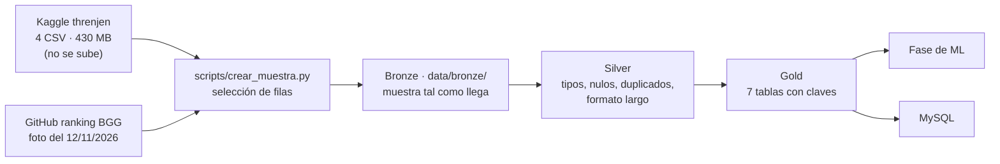

# Entrega 02 · Datos y preparación

**Proyecto:** recomendador de juegos de mesa · **Autor:** Fernando López Sánchez · **Fecha:** noviembre de 2026

Esta entrega es una muestra de los datos. El repositorio solo incluye una muestra pequeña de los datos reales (500 juegos y unos 1.800 usuarios, 1,8 MB), suficiente para construir y probar los primeros modelos. Los ficheros completos (430 MB) no los subo. El pipeline lee únicamente esa muestra, así que se puede ejecutar sin descargar nada.

---

## 1. Qué datos necesita el producto

Una valoración explícita, una nota de 1 a 10, de un usuario a un juego. La granularidad es usuario × juego, con una fila por par.

| Tipo | Datos | Para qué |
|---|---|---|
| **Imprescindibles** | Identificador de usuario, identificador de juego, nota | Modelo colaborativo: quién valora qué y cuánto |
| | Ficha del juego: nombre, año, mecánicas, temas, complejidad (peso), nº de jugadores, duración, edad mínima | Modelo por contenido, juegos sin valoraciones y filtros ("somos 5", "menos de una hora") |
| **Deseables** | Fecha de cada valoración | Separar entrenamiento y test por tiempo |
| | Colección del usuario (tiene, desea, ha jugado) | Señales implícitas, más abundantes que las notas |
| | Ranking y número de votos actuales | Popularidad reciente y juegos nuevos |
| | Disponibilidad y precio en España | Recomendaciones que se puedan comprar |

**Histórico.** El recomendador no necesita una serie temporal: basta una foto de las valoraciones. Como la fuente no tiene fechas, la evaluación se hará reservando *k* valoraciones de cada usuario. Por eso el Gold exige al menos 10 valoraciones por usuario. Para la popularidad actual basta una foto reciente del ranking.

## 2. Fuentes reales y viabilidad

Kaggle · Board Games Database from BoardGameGeek (threnjen) | 21.925 juegos, 18.942.215 valoraciones y 411.375 usuarios | Foto única: el juego más reciente es de 2021 y no se actualiza | Contiene: valoraciones, ficha, mecánicas y temas.

GitHub · `beefsack/bgg-ranking-historicals` | HTTPS sin autenticación, un CSV por día | 31.579 juegos rankeados el 12/11/2026 | Diaria desde el 12/10/2016 | Complementaria: ranking y número de votos actuales.

API XML de BoardGameGeek | Token tras registrar la aplicación | Catálogo completo | Fuera de esta entrega. Más adelante: fichas de juegos nuevos y colección del usuario.

**Viabilidad.** Las dos fuentes usadas comparten la clave `bgg_id` (el ID de juego de BGG), así que se unen sin emparejar por nombre. Comparado con el ranking de hoy:
- Entre los juegos ausentes, por no tener esa actualización desde 2021, hay 23 del top 100 actual.

**Alternativas si una fuente deja de estar disponible:**
- **Kaggle threnjen:** el dataset de jvanelteren en Kaggle (misma foto de 2022 y mismas claves, con comentarios de texto) o una descarga propia con la API.
- **Ranking de GitHub:** es un proyecto personal y puede dejar de actualizarse. La alternativa es el volcado diario oficial de BGG (`boardgamegeek.com/data_dumps/bg_ranks`, requiere cuenta).

## 3. Uso, privacidad y datos personales

**Condiciones de uso.** Todos los datos proceden de BoardGameGeek (BGG). Que se descarguen desde Kaggle o GitHub no cambia sus condiciones. Los términos de la API XML de BGG dicen:
- licencia solo para uso no comercial;
- citar a BGG como fuente y mostrar el logo "Powered by BGG" en cualquier uso público;
- prohibido usar la API o cualquier dato del sitio para entrenar sistemas de IA o LLM;
- no se pueden modificar los datos obtenidos.

Licencia declarada en Kaggle para el dataset de threnjen: CC BY-SA 3.0 (consultada a dia 13/11/2026). El repositorio de GitHub no declara licencia, así que se aplican las condiciones de BGG.

El 10 de noviembre de 2026 envié a BGG una solicitud de permiso para uso académico, que incluye entrenar un modelo de recomendación. Está pendiente de respuesta. Mientras tanto puedo seguir trabajando con los datos históricos públicos de BGG y si me acaban permitiendo el acceso lo usare para tener el catálogo actualizado y tener posibilidad a añadir mas funcionalidades.

**Datos personales.** El único dato personal es el nombre de usuario de BGG. Es un alias público, pero puede identificar a una persona. Al crear la muestra la columna `Username` se sustituye por `UserRef`, un número consecutivo sin relación con el nombre. La correspondencia entre nombre y número no se guarda en ningún sitio. El resto de valores se copian sin cambios.
- **Minimización:** no se recogen comentarios, imágenes, país ni otros datos de perfil. La muestra contiene el 0,4 % de los usuarios (1.764 de 411.375).

## 4. Del dato bruto al dato utilizable

Hay dos scripts:

| Script | Qué hace | Quién lo ejecuta |
|---|---|---|
| `scripts/crear_muestra.py` | Adquisición: lee los ficheros completos y copia en `data/bronze/` las filas de la muestra | El autor, una vez. Necesita los datos de Kaggle |
| `src/pipeline_datos.py` | Bronze → Silver → Gold, leyendo solo `data/bronze/` | Cualquiera: `python src/pipeline_datos.py` |

Cada ejecución del pipeline deja en `data/gold/_informe_calidad.json` el recuento de filas y de correcciones de cada paso. Las cifras de la muestra que aparecen aquí salen de ese informe; las de los ficheros completos, de `data/bronze/_manifiesto.json`.

### Bronze: la muestra real, tal como llega

`crear_muestra.py` solo **selecciona filas**. No limpia, no convierte tipos y no cambia ningún valor: lee todo como texto y lo escribe igual. Se ha comprobado fila a fila que la muestra coincide con la fuente. La selección es reproducible:
1. **Juegos:** los 500 con más valoraciones. Concentran el 49,3 % de todas las valoraciones; el que menos tiene suma 7.590.
2. **Usuarios:** el 0,5 % de los usuarios, elegidos por el hash MD5 de su nombre con una semilla pública. La selección no depende del orden del fichero y da siempre la misma muestra.
3. Se copian todas las valoraciones de esos usuarios sobre esos juegos, con `Username` sustituido por `UserRef` (ver apartado 3).

| Fichero en `data/bronze/` | Filas | Origen |
|---|---|---|
| `games.csv`, `mechanics.csv`, `themes.csv` | 500 cada uno | Kaggle, mismas columnas y valores |
| `user_ratings.csv` | 48.204 valoraciones de 1.764 usuarios | Kaggle, columnas `BGGId`, `Rating`, `UserRef` |
| `bgg_ranks_2026-11-12.csv` | 499 | GitHub, mismas columnas y valores |
| `_manifiesto.json` | — | URLs, huella SHA-256 de los ficheros completos y criterio de selección |

### Silver: transformaciones

El pipeline trata todos los problemas que se encontraron al analizar los ficheros completos, aunque algunos no aparezcan en la muestra.

| Problema encontrado | Ejemplo | Tratamiento | En la muestra | En el fichero completo |
|---|---|---|---|---|
| Un 0 significa "no informado" | `MaxPlayers` = 0, `GameWeight` = 0, `MfgAgeRec` = 0 | → nulo | 0 | 173, 506 y 1.325 juegos |
| Valor centinela de "sin ranking" | `Rank:boardgame` = 21926 | → nulo | 3 | 347 |
| Máximo de jugadores menor que el mínimo | `MaxPlayers` = 0 con `MinPlayers` = 2 | → nulo | 0 | 132 |
| Lista guardada como texto | `GoodPlayers = "['2', '3', '4']"` | → `buenos_jugadores_min` / `_max` | 5 sin dato | — |
| Formato ancho 0/1 | 157 columnas de mecánicas y 217 de temas | → pares juego-mecánica y juego-tema | 3.166 y 1.209 pares | — |
| Usuario llamado literalmente "null" | pandas lo convierte en nulo al leer | se lee como texto sin convertir nulos | — | 63 valoraciones |
| Nota fuera de la escala 1-10 | 0,0001 o 0,5 | → se elimina | 0 | 8 |
| Mismo usuario y juego con dos notas | diferencia mediana de 1 punto | → media (sin fecha no se sabe cuál es la última) | 95 pares (190 filas) | — |
| Fila repetida en el ranking (error de paginación) | mismo juego dos veces | → se elimina la copia | 1 | 143 IDs repetidos |
| Años negativos | Go, Backgammon | se conservan: son juegos antiguos | 2 | 11 |
| Columnas sin valor para el producto | `ImagePath`, `LanguageEase` (escala no documentada), `Family` | → se descartan | 3 columnas | — |
| Nombres y tipos | `Rank:boardgame`, números leídos como texto | nombres en español sin espacios, enteros con nulos | todas | — |

La descripción de los juegos ya llega preprocesada desde Kaggle (en minúsculas, sin palabras vacías y lematizada). Sirve para un modelo por contenido, pero no para mostrarla al usuario.

### Gold: lo que consumirá la fase de ML

Primero se filtra de forma iterativa hasta quedarse con usuarios con 10 valoraciones o más y juegos con 5 o más. Esto elimina 2.935 valoraciones, todas de usuarios con pocas notas. Después se generan siete tablas en CSV (1,3 MB), con claves listas para cargarlas en MySQL.

| Tabla | Una fila es… | Filas | Columnas principales | Uso |
|---|---|---|---|---|
| `valoraciones` | la nota de un usuario a un juego | 45.174 | `user_id`, `bgg_id`, `nota`, `positiva` (nota ≥ 7) | Entrenar y evaluar el modelo colaborativo |
| `juegos` | un juego del catálogo demo | 500 | `bgg_id`, `nombre`, `anio`, `peso`, `min/max_jugadores`, `duracion_min`, `nota_bayes_bgg`, `ranking_actual`, `crecimiento_votos` | Modelo por contenido, filtros y línea base de popularidad |
| `usuarios` | un usuario | 920 | `user_id`, `n_valoraciones`, `nota_media`, `nota_desv` | Normalizar notas por usuario y simular usuarios nuevos |
| `mecanicas`, `temas` | una mecánica o un tema | 148 / 121 | `mecanica_id`, `mecanica` / `tema_id`, `tema` | Catálogos |
| `juego_mecanica`, `juego_tema` | la relación entre un juego y una mecánica o tema | 3.166 / 1.209 | `bgg_id`, `mecanica_id` / `tema_id` | Rasgos del modelo por contenido |

`user_id` es el mismo `UserRef` de Bronze, así que cada valoración se puede rastrear hasta su fila de origen.

**Perfil del Gold:**
- La matriz usuario × juego está ocupada al 9,8 %.
- Cada usuario tiene una mediana de 30 valoraciones (percentil 90: 104; máximo: 476).
- La nota media es 7,41, con desviación típica de 1,40. El 76,1 % de las valoraciones son positivas (≥ 7).
- 498 juegos tienen ranking actual. Los otros 2 ya no aparecen en el ranking, y 16 han cambiado de nombre desde la foto de Kaggle.

**Validaciones automáticas.** El pipeline comprueba que las claves primarias son únicas, que toda valoración apunta a un juego y a un usuario existentes y que las notas están entre 1 y 10. Si alguna comprobación falla, se detiene.

## 5. Riesgos y limitaciones

- **Dato que falta:** las valoraciones no tienen fecha, lo que impide separar entrenamiento y test por tiempo. Tampoco hay señales implícitas (colección, deseados) ni datos de disponibilidad en España.
- **Sesgo:** los usuarios de BGG son aficionados intensivos, y el 76 % de las notas de la muestra son ≥ 7. Además, la demo se limita a los 500 juegos más populares, así que todavía no permite medir la recomendación de la cola larga. La versión completa usará todo el catálogo.
- **Desactualización:** la foto de Kaggle es de 2021-2022. Le faltan 10.118 juegos rankeados hoy, incluidos 23 del top 100.
- **Si cae una fuente:** Kaggle se sustituye por jvanelteren o por la API con token, y el ranking de GitHub por el volcado oficial de BGG. Si BGG no autoriza el uso, se recogerán valoraciones propias mediante una encuesta y se aplicará el mismo pipeline.

---

*Datos: BoardGameGeek, vía Kaggle (threnjen) y GitHub (beefsack/bgg-ranking-historicals). Powered by BGG.*
